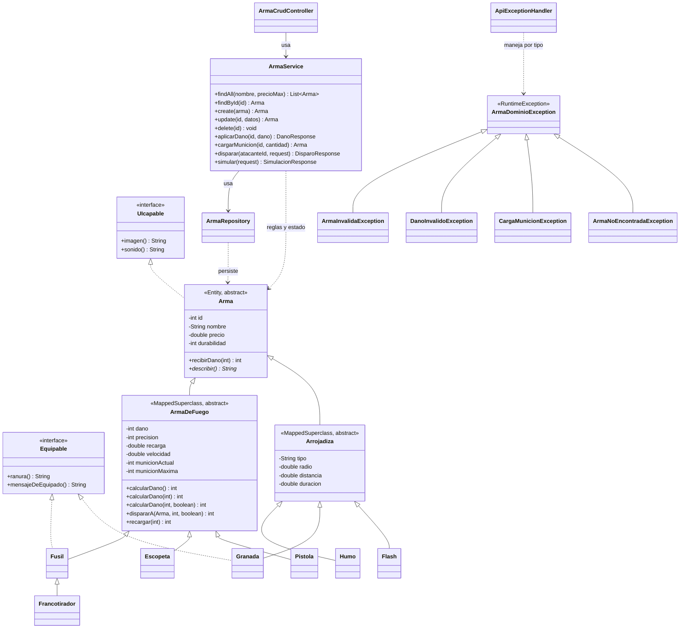

# cs2-armas-api

Servicio HTTP construido con **Spring Boot** (Maven, Java 21, Spring Web + Spring Data JPA + H2) sobre el modelado de **Counter-Strike 2**: inventario de armas con herencia, sobreescritura/sobrecarga, interfaces, CRUD REST persistido, reglas de negocio de **daño**, **disparo** y **carga de munición**, una **simulación** transaccional que involucra tres clases y persiste el resultado, consulta a una API externa con **WebClient**, documentación **OpenAPI** con **Swagger UI** y una **colección Insomnia** exportable para probar todo el flujo.

Ejercicios: POO-06/07/08 del taller de Git y Lenguaje de Programación 3 (CYT646).  
POO-08: <https://github.com/alefq/afq-taller-git-2024/blob/main/docs/ejercicio-poo-08-crud-h2-insomnia-2026-10-28.md>

## Cómo arrancar

```bash
./mvnw spring-boot:run
```

Servicio: `http://localhost:8080`. Pruebas:

```bash
./mvnw test
```

## H2 y persistencia (desarrollo)

Configuración en `src/main/resources/application.properties`:
- `spring.datasource.url=jdbc:h2:mem:armasdb` — base H2 en memoria para desarrollo.
- `spring.datasource.username=sa` / `spring.datasource.password=` — credenciales por defecto.
- `spring.h2.console.enabled=true` y `spring.h2.console.path=/h2-console` — consola web para inspeccionar tablas.
- `spring.jpa.hibernate.ddl-auto=update` — Hibernate crea/actualiza el esquema al arrancar.
- `spring.jpa.show-sql=true` — muestra SQL para depuración.
- `spring.jackson.deserialization.fail-on-unknown-properties=true` — rechaza propiedades JSON desconocidas.

Consola H2: `http://localhost:8080/h2-console` (JDBC URL `jdbc:h2:mem:armasdb`, usuario `sa`). La base es en memoria: al reiniciar se pierden los datos y los ids vuelven a empezar.

## Modelo persistido: la jerarquía del dominio es la jerarquía JPA

No hay una entidad paralela: **`Arma` es la entidad raíz**. La jerarquía de POO se persiste con una única tabla y un discriminador.

- `Arma`: `@Entity`, `@Table(name = "armas")`, `@Inheritance(SINGLE_TABLE)` y `@DiscriminatorColumn(name = "tipo_arma")`.
- `ArmaDeFuego` y `Arrojadiza`: `@MappedSuperclass` (ramas intermedias, sin tabla propia).
- `Fusil`, `Escopeta`, `Pistola`, `Francotirador`, `Humo`, `Granada` y `Flash`: `@Entity` + `@DiscriminatorValue` (`FUSIL`, `ESCOPETA`, `PISTOLA`, `FRANCOTIRADOR`, `HUMO`, `GRANADA`, `FLASH`).
- `id`: `@Id @GeneratedValue(strategy = IDENTITY)` y `@JsonProperty(access = READ_ONLY)`; lo asigna H2 y no se envía al crear.
- Jackson distingue el subtipo con la propiedad `tipoArma` (`@JsonTypeInfo` / `@JsonSubTypes`). Los constructores sin argumentos se usan para JPA/Jackson; los constructores con parámetros están marcados con `@JsonCreator(mode = DISABLED)` para que Jackson no los confunda con creadores.
- Columnas homónimas entre subtipos se renombran con `@Column` para evitar colisiones en `SINGLE_TABLE` (por ejemplo `dano_explosivo`, `fusil_automatica`, `pistola_silenciador`, `fusil_silenciador`, `pistola_automatica`).

### Jerarquía de clases

```text
Arma (@Entity, SINGLE_TABLE, discriminator tipo_arma, implements UIcapable)
├─ ArmaDeFuego (@MappedSuperclass)
│  ├─ Fusil (@Entity, implements Equipable)
│  │  └─ Francotirador (@Entity)
│  ├─ Escopeta (@Entity)
│  └─ Pistola (@Entity)
└─ Arrojadiza (@MappedSuperclass)
   ├─ Humo (@Entity)
   ├─ Granada (@Entity, implements Equipable)
   └─ Flash (@Entity)
```

### Interfaces

- `Equipable`: declara `ranura()` y un `mensajeDeEquipado()` por defecto. La implementan `Fusil` (`ranura() = "primaria"`) y `Granada` (`ranura() = "explosiva"`, mensaje propio con tecla G). Son familias distintas (`ArmaDeFuego` y `Arrojadiza`).
- `UIcapable`: declara `imagen()` y `sonido()`. La implementa la raíz `Arma`, por lo que todas las clases concretas la heredan. Las rutas se derivan del nombre simple de la clase, por ejemplo `recursos/imagenes/fusil.png` y `recursos/sonidos/flash.mp3`.

## Reglas por clase / restricciones de arma

Las validaciones, reglas de negocio y excepciones se aplican en la **capa service** (`ArmaService`). El dominio/entity mantiene estado encapsulado (getters/setters y comportamiento de estado), pero no contiene la lógica de validación de entrada. Esto evita dejar objetos inválidos al crear/actualizar y centraliza las reglas en el servicio.

| Clase/familia | Restricciones |
|---|---|
| `Arma` (todas) | `nombre` no nulo/vacío; `precio >= 0`; `durabilidad > 0` al crear/actualizar; `id` lo asigna la persistencia y no debe enviarse al crear. |
| `ArmaDeFuego` (Fusil, Escopeta, Pistola, Francotirador) | `dano >= 0`; `precision` entre 0 y 100; `recarga > 0`; `velocidad >= 0`; `municionActual >= 0`; `municionMaxima > 0`; `municionActual <= municionMaxima`. |
| `Fusil` (+ Francotirador por herencia) | `mira >= 0`; `retroceso >= 0`. |
| `Escopeta` | `perdigon >= 0`; `dispersion >= 0`. |
| `Pistola` | Sin extras; hereda las reglas de `ArmaDeFuego`. |
| `Francotirador` | `alcance >= 0`; `zoom >= 0`; hereda reglas de `Fusil`/`ArmaDeFuego`. |
| `Arrojadiza` (Humo, Granada, Flash) | `tipo` no vacío; `radio > 0`; `distancia > 0`; `duracion > 0`. |
| `Granada` | `dano` explosivo `>= 0`. |
| `Flash` | `intensidad >= 0`; `duracionCeguera >= 0`. |
| `Humo` | Sin extras; hereda las reglas de `Arrojadiza`. |

**Nota sobre durabilidad 0**: no se puede crear ni actualizar un arma con `durabilidad: 0`. La durabilidad en 0 solo ocurre en runtime cuando recibe daño suficiente; en ese caso el arma se destruye y se elimina de la persistencia.

## CRUD REST (persistido en H2)

Recurso: `/api/armas`. El verbo HTTP indica la operación. El controller solo traduce HTTP; las validaciones y reglas viven en `ArmaService` y el dominio mantiene el estado.

| Operación | HTTP | URL | Éxito |
|---|---|---|---|
| Crear (polimórfico) | `POST` | `/api/armas` | 201 |
| Crear por subtipo | `POST` | `/api/armas/{fusil,escopeta,pistola,francotirador,humo,granada,flash}` | 201 |
| Listar / filtrar | `GET` | `/api/armas?nombre=...&precioMax=...` | 200 |
| Obtener por id | `GET` | `/api/armas/{id}` | 200 / 404 |
| Actualizar | `PUT` | `/api/armas/{id}` | 200 |
| Borrar | `DELETE` | `/api/armas/{id}` | 204 |
| Aplicar daño | `POST` | `/api/armas/{id}/dano` | 200 |
| Cargar munición | `POST` | `/api/armas/{id}/cargar-municion` | 200 |
| Disparar | `POST` | `/api/armas/{id}/disparar` | 200 |
| Simulación | `POST` | `/api/armas/simulacion` | 200 |

Filtros de listado: `nombre` (contiene, sin distinguir mayúsculas) y `precioMax` (precio menor o igual). Si se envía `nombre`, tiene prioridad.

### Crear un Fusil

```bash
curl -X POST "http://localhost:8080/api/armas" -H "Content-Type: application/json" \
  -d '{
    "tipoArma": "FUSIL",
    "nombre": "AK-47",
    "precio": 2700,
    "durabilidad": 100,
    "dano": 36,
    "precision": 71,
    "recarga": 2.4,
    "velocidad": 600,
    "municionActual": 30,
    "municionMaxima": 30,
    "automatica": true,
    "mira": 2,
    "retroceso": 3,
    "silenciador": false
  }'
```

También se puede crear por endpoint de subtipo (sin necesidad de `tipoArma` en el cuerpo):

```bash
curl -X POST "http://localhost:8080/api/armas/humo" -H "Content-Type: application/json" \
  -d '{
    "nombre": "Bomba de humo",
    "precio": 300,
    "durabilidad": 100,
    "tipo": "humo",
    "radio": 6.0,
    "distancia": 25.0,
    "duracion": 18.0
  }'
```

### Crear un Humo (polimórfico)

```bash
curl -X POST "http://localhost:8080/api/armas" -H "Content-Type: application/json" \
  -d '{
    "tipoArma": "HUMO",
    "nombre": "Humo de cortina",
    "precio": 300,
    "durabilidad": 100,
    "tipo": "humo",
    "radio": 6.0,
    "distancia": 25.0,
    "duracion": 18.0
  }'
```

### Crear una Pistola

```bash
curl -X POST "http://localhost:8080/api/armas" -H "Content-Type: application/json" \
  -d '{
    "tipoArma": "PISTOLA",
    "nombre": "USP-S",
    "precio": 200,
    "durabilidad": 100,
    "dano": 35,
    "precision": 70,
    "recarga": 1.5,
    "velocidad": 352,
    "municionActual": 12,
    "municionMaxima": 20,
    "automatica": false,
    "silenciador": true
  }'
```

### Listar, obtener, actualizar y borrar

```bash
curl "http://localhost:8080/api/armas"
curl "http://localhost:8080/api/armas?nombre=AK"
curl "http://localhost:8080/api/armas?precioMax=500"
curl "http://localhost:8080/api/armas/1"

curl -X PUT "http://localhost:8080/api/armas/1" -H "Content-Type: application/json" \
  -d '{
    "tipoArma": "FUSIL",
    "nombre": "M4A1-S",
    "precio": 3100,
    "durabilidad": 90,
    "dano": 33,
    "precision": 66,
    "recarga": 3.1,
    "velocidad": 585,
    "municionActual": 25,
    "municionMaxima": 25,
    "automatica": false,
    "mira": 4,
    "retroceso": 2,
    "silenciador": true
  }'

curl -X DELETE "http://localhost:8080/api/armas/1" -i
```

## Operaciones individuales: daño, recarga y disparo

### Aplicar daño

```bash
curl -X POST "http://localhost:8080/api/armas/1/dano" \
  -H "Content-Type: application/json" -d '{"dano":40}'
```

- El daño no puede ser negativo (`400 DANO_INVALIDO`).
- Si el daño supera la durabilidad disponible, se **clampa** al valor restante.
- Devuelve `200` con `DanoResponse` (`id`, `nombre`, `durabilidad`, `danoAplicado`, `destruida`).
- Si la durabilidad llega a 0, el arma se **destruye** (se elimina) y la respuesta trae `destruida: true`.

### Cargar munición

```bash
curl -X POST "http://localhost:8080/api/armas/3/cargar-municion" \
  -H "Content-Type: application/json" -d '{"cantidad":5}'
```

- Solo disponible para `ArmaDeFuego`; una arrojadiza responde `400 ARMA_INVALIDA`.
- La cantidad debe ser mayor a 0; cantidad `<= 0` responde `400 CARGA_MUNICION_INVALIDA`.
- La recarga **llena al máximo**: `municionActual` pasa a `municionMaxima`. Si la cantidad excede el espacio disponible, no hay error; simplemente queda llena.
- Responde `200` con el arma actualizada.

### Disparar

```bash
curl -X POST "http://localhost:8080/api/armas/1/disparar" \
  -H "Content-Type: application/json" \
  -d '{"objetivoId": 2, "distancia": 0, "critico": false}'
```

Request (`DisparoRequest`):

```json
{
  "objetivoId": 2,
  "distancia": 0,
  "critico": false
}
```

Response (`DisparoResponse`):

```json
{
  "atacanteId": 1,
  "atacanteNombre": "AK-47",
  "atacanteMunicionAntes": 30,
  "atacanteMunicionDespues": 29,
  "objetivoId": 2,
  "objetivoNombre": "Humo de cortina",
  "objetivoDurabilidadAntes": 100,
  "objetivoDurabilidadDespues": 64,
  "danoAplicado": 36,
  "objetivoDestruido": false
}
```

Reglas del disparo:
- El atacante debe existir y ser `ArmaDeFuego`.
- El objetivo debe existir; atacante y objetivo deben ser armas distintas.
- `distancia` no puede ser negativa.
- El atacante debe tener munición disponible; si no, `400 CARGA_MUNICION_INVALIDA`.
- El disparo calcula daño (`calcularDano(distancia, critico)`), lo aplica al objetivo, consume 1 bala y persiste ambos cambios.
- Si el objetivo llega a durabilidad 0, se destruye/elimina y `objetivoDestruido` es `true`.

## Simulación REST que involucra tres clases y persiste el resultado

La simulación usa tres armas ya persistidas y tres comportamientos distintos del dominio:

1. Un **ArmaDeFuego atacante** dispara y daña al objetivo.
2. El objetivo recibe daño (puede ser destruido si llega a 0).
3. Un **ArmaDeFuego recargador** recarga munición y queda en su máximo.

Request (`POST /api/armas/simulacion`):

```json
{
  "atacanteId": 1,
  "objetivoId": 2,
  "recargadorId": 3,
  "distancia": 0,
  "critico": false,
  "municion": 5
}
```

Con el Fusil AK-47 (36 de daño), el Humo (100 de durabilidad) y la Pistola USP-S (12/20), la respuesta es:

```json
{
  "atacanteClase": "Fusil",
  "atacanteMunicionAntes": 30,
  "atacanteMunicionDespues": 29,
  "objetivoClase": "Humo",
  "objetivoDurabilidadAntes": 100,
  "objetivoDurabilidadDespues": 64,
  "recargadorClase": "Pistola",
  "recargadorMunicionAntes": 12,
  "recargadorMunicionDespues": 20,
  "danoAplicado": 36,
  "municionRecargada": 5,
  "objetivoDestruido": false
}
```

Verificación del estado persistido:

```bash
curl "http://localhost:8080/api/armas/1"   # municionActual = 29
curl "http://localhost:8080/api/armas/2"   # durabilidad = 64
curl "http://localhost:8080/api/armas/3"   # municionActual = 20 (llena al máximo)
```

La simulación exige tres ids distintos, que el atacante y el recargador sean `ArmaDeFuego`, y que la munición a recargar sea mayor a 0. La recarga llena al máximo (no falla por exceso). Si algo falla, la transacción revierte y no queda estado parcial.

## Reglas de negocio y excepciones

Las reglas viven en el **service** y las operaciones de estado en el **dominio**; el controller no asigna estado inválido directamente.

- `ArmaService.create/update`: valida el estado completo del arma antes de persistir. No permite crear con `id != 0`, ni actualizar cambiando el subtipo.
- `Arma.recibirDano(int)`: aplica clamp `min(dano, durabilidad)` y descuenta; devuelve el daño efectivamente aplicado. El service valida que el daño no sea negativo.
- `ArmaService.aplicarDano`: si la durabilidad llega a 0, elimina el arma y devuelve `DanoResponse` con `destruida=true`.
- `ArmaDeFuego.dispararA(...)`: calcula daño, aplica `recibirDano` y descuenta una bala. El service valida atacante/objetivo, tipo, munición disponible y distancia.
- `ArmaDeFuego.recargar(int)`: llena la munición al máximo. El service valida que la cantidad sea `> 0` y que el arma sea `ArmaDeFuego`.
- `ArmaDeFuego.calcularDano()` / `calcularDano(int)` / `calcularDano(int, boolean)`: daño base, ajuste por distancia (`max(1, dano - distancia / 10)`) y crítico (x2).

Jerarquía de excepciones (no comprobadas, `RuntimeException` vía `ArmaDominioException`):

- `ArmaDominioException` (base)
  - `ArmaInvalidaException`
  - `DanoInvalidoException`
  - `CargaMunicionException`
  - `ArmaNoEncontradaException`

Handlers HTTP (`ApiExceptionHandler`):

| Excepción / caso | HTTP | `tipo` en JSON |
|---|---|---|
| `ArmaNoEncontradaException` | 404 | `ARMA_NO_ENCONTRADA` |
| `ArmaInvalidaException` | 400 | `ARMA_INVALIDA` |
| `DanoInvalidoException` | 400 | `DANO_INVALIDO` |
| `CargaMunicionException` | 400 | `CARGA_MUNICION_INVALIDA` |
| `ArmaDominioException` (resto) | 400 | `DOMINIO` |
| `NotFound` (API externa) | 404 | `OBJETO_EXTERNO_NO_ENCONTRADO` |
| `WebClientException` | 502 | `SERVICIO_EXTERNO_NO_DISPONIBLE` |
| Cuerpo JSON inválido / no legible / propiedades desconocidas | 400 | `CUERPO_INVALIDO` |
| Parámetro de URL inválido / `IllegalArgumentException` | 400 | `PARAMETRO_INVALIDO` |

Si durante la deserialización del cuerpo la causa es una excepción de dominio, se delega al handler correspondiente para preservar el `tipo` específico.

## Consulta a API externa con WebClient

`ObjetoExternoService` usa el `WebClient.Builder` autoconfigurado por Spring Boot para consultar `https://api.restful-api.dev/objects`. La URL base es configurable con `api.restful.base-url` en `application.properties`. El servicio devuelve tipos reactivos (`Flux`/`Mono`) y el DTO `ObjetoExterno` (`id`, `name`, `data`, `createdAt`).

| Operación | HTTP | URL | Éxito |
|---|---|---|---|
| Listar objetos externos | `GET` | `/api/objetos` | 200 |
| Obtener objeto externo por id | `GET` | `/api/objetos/{id}` | 200 / 404 |

```bash
curl "http://localhost:8080/api/objetos"
curl "http://localhost:8080/api/objetos/1"
```

Un 404 de la API externa se traduce a `OBJETO_EXTERNO_NO_ENCONTRADO` (404); cualquier otro fallo de WebClient se traduce a `SERVICIO_EXTERNO_NO_DISPONIBLE` (502). El proyecto usa **Log4j2** con DEBUG para las clases de integración.

## Documentación OpenAPI y Swagger UI

El starter `springdoc-openapi-starter-webmvc-ui` genera el documento desde los controladores anotados (`@Tag`, `@Operation`, `@Parameter`, `@ApiResponse`) y los DTOs (`@Schema`). Los metadatos viven en `OpenApiConfig`.

- JSON: `http://localhost:8080/v3/api-docs`
- Swagger UI: `http://localhost:8080/swagger-ui.html`

## Endpoints POO-06/07 (demostración de modelado)

- `GET /` — estado del servicio y lista de endpoints.
- `GET /api/armas/descripcion` — `describir()` abstracto/sobreescrito (polimorfismo).
- `GET /api/armas/equipables` — capacidad `Equipable` entre familias distintas.
- `GET /api/armas/ui` — capacidad `UIcapable` en todas las clases.
- `GET /api/armas/fusil?...` / `GET /api/armas/humo?...` — construcción desde URL y sobrecarga.

## Colección Insomnia

- Exportable: [`docs/insomnia-poo08.json`](docs/insomnia-poo08.json)
- Guía: [`docs/insomnia-poo08.md`](docs/insomnia-poo08.md)

Importar en Insomnia desde **Import/Export → Import Data → From File**, activar el environment `Local` y seguir el orden de la guía.

## Diagrama (resumen POO-08)



## Qué hay que pensar (respuestas)

Estas respuestas describen la implementación actual; si el código cambia, deben cambiar con él.

1. **Recurso y verbo.** El sustantivo de la API es `armas` y la colección vive en `/api/armas`. El verbo HTTP expresa la operación: `POST` crea, `GET` lee, `PUT` actualiza y `DELETE` borra. Las acciones que cambian estado se exponen como subrecursos de comando: `POST /api/armas/simulacion`, `POST /api/armas/{id}/dano`, `POST /api/armas/{id}/cargar-municion` y `POST /api/armas/{id}/disparar`.

2. **Identidad.** La clave es `id`, un `int` asignado por JPA/H2 con `@GeneratedValue(strategy = IDENTITY)`. El JSON de creación la omite: el campo es `@JsonProperty(access = READ_ONLY)`. El service además rechaza un `id` distinto de 0 al crear. La persistencia asigna el id y el `POST` lo devuelve en la respuesta.

3. **Herencia y tablas.** Se eligió `SINGLE_TABLE` con `@Inheritance` y `@DiscriminatorColumn(name = "tipo_arma")` porque toda la familia comparte identidad y campos comunes, y una sola tabla/repositorio alcanza para CRUD y consultas polimórficas. `Arma` es la entidad raíz; `ArmaDeFuego` y `Arrojadiza` son `@MappedSuperclass`; las clases concretas son `@Entity` con `@DiscriminatorValue`. En JSON el subtipo se distingue con `tipoArma`. El costo es que las columnas de subtipos quedan anulables.

4. **Interfaz y repositorio.** `ArmaRepository` extiende `JpaRepository<Arma, Integer>`; Spring Data genera la implementación y el service depende del contrato. El controller depende de `ArmaService`, y el service del repositorio. Esto facilita consultas derivadas, mockeo en pruebas y cambios de implementación sin tocar el controller. La misma idea aplica a `Equipable` y `UIcapable`: el cliente usa el mensaje sin conocer la clase concreta.

5. **Protocolo del dominio.** `Equipable` declara `ranura()` y `mensajeDeEquipado()` por defecto. Lo implementan `Fusil` (familia `ArmaDeFuego`) y `Granada` (familia `Arrojadiza`), así que `GET /api/armas/equipables` trabaja con `List<Equipable>`. `UIcapable` (`imagen()`, `sonido()`) está implementada en la raíz `Arma` y la usa `GET /api/armas/ui`.

6. **Ocultamiento y validación.** El dominio/entity expone estado encapsulado con getters/setters simples y operaciones de estado (`recibirDano`, `dispararA`, `recargar`, `calcularDano`). Las validaciones, reglas de negocio y lanzamiento de excepciones se realizan en la **capa service** antes de persistir o ejecutar acciones. Por ejemplo, `ArmaService.create`/`update` validan el estado completo; `aplicarDano` rechaza daño negativo; `cargarMunicion` exige cantidad `> 0` y arma de fuego; `disparar` valida ids, tipo, distancia y munición. No se permite crear/actualizar con `durabilidad: 0`; la durabilidad 0 solo aparece en runtime por destrucción.

7. **PUT y PATCH.** Solo está implementado `PUT /api/armas/{id}`; no hay `PATCH`. El `PUT` reemplaza el estado editable del recurso: conserva el `id`, no permite cambiar el subtipo y copia todas las propiedades del cuerpo sobre el existente. Un campo omitido queda en valor por defecto de Java y puede producir error de validación; el cliente debe enviar la representación completa.

8. **DELETE.** Borrar significa eliminar físicamente la fila: `ArmaService.delete` busca por id y llama a `armaRepository.delete(arma)`; responde 204 y un `GET` posterior por ese id da 404. La destrucción por daño también elimina el arma cuando la durabilidad llega a 0.

9. **Tres clases y simulación.** La simulación `POST /api/armas/simulacion` involucra atacante `ArmaDeFuego`, objetivo `Arma` y recargador `ArmaDeFuego`. El atacante dispara, el objetivo recibe daño y el recargador llena su munición al máximo. La operación es transaccional: si falla una regla, se revierte el estado.

10. **Excepciones.** La base es `ArmaDominioException extends RuntimeException`. Hijas: `ArmaInvalidaException` (estado/entrada/tipo inválido), `DanoInvalidoException` (daño negativo), `CargaMunicionException` (cantidad inválida, sin munición, munición fuera de rango) y `ArmaNoEncontradaException` (recurso inexistente). `ApiExceptionHandler` es un `@RestControllerAdvice` que mapea cada tipo a HTTP/JSON con `tipo`, `error` y `rechazo`. El sobre-daño no es error: se clampa y puede destruir el arma.

## Estructura

```
src/main/java/py/edu/uc/lp3/Application.java
src/main/java/py/edu/uc/lp3/domain/                     modelado CS2 + entidades JPA
src/main/java/py/edu/uc/lp3/exceptions/                 jerarquía de excepciones del dominio
src/main/java/py/edu/uc/lp3/repository/ArmaRepository   Spring Data (interfaz)
src/main/java/py/edu/uc/lp3/service/ArmaService.java    negocio/validación + reglas + simulación
src/main/java/py/edu/uc/lp3/service/ObjetoExternoService.java  consulta WebClient a API externa
src/main/java/py/edu/uc/lp3/rest/config/OpenApiConfig.java     metadatos OpenAPI
src/main/java/py/edu/uc/lp3/rest/controller/            REST + handlers
src/main/java/py/edu/uc/lp3/rest/dto/                   request/response de simulación, disparo, daño y objeto externo
src/test/java/py/edu/uc/lp3/                           pruebas dominio/HTTP/servicios
docs/insomnia-poo08.json                               colección exportable
docs/insomnia-poo08.md                                 guía de uso de la colección
```

## Licencia

Apache License 2.0. Ver [LICENSE](LICENSE).

## Bitácora

- [BITACORA.md](BITACORA.md)
