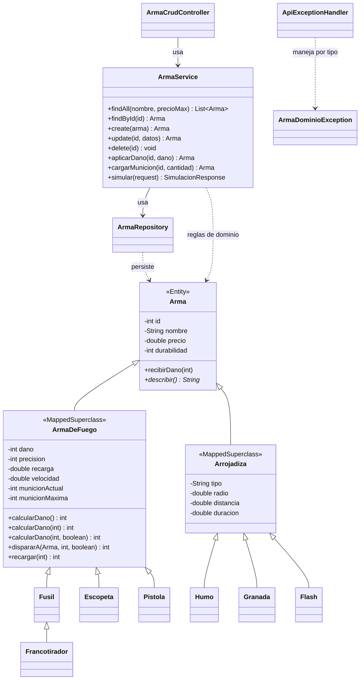

# cs2-armas-api

Servicio HTTP construido con **Spring Boot** (Maven, Java 21, Spring Web + Spring Data JPA + H2) sobre el modelado de **Counter-Strike 2**: inventario de armas con herencia, sobreescritura/sobrecarga, ocultamiento, CRUD REST persistido, reglas de negocio de **daño** y **carga de munición**, y una **simulación** que involucra tres clases y persiste el resultado.

Ejercicios: POO-06/07/08 del taller de Git y Lenguaje de Programación 3 (CYT646).  
POO-08: <https://github.com/alefq/afq-taller-git-2024/blob/main/docs/ejercicio-poo-08-crud-h2-insomnia-2026-10-28.md>

## Cómo arrancar

```bash
./mvnw spring-boot:run
```

Servicio: `http://localhost:8080`. Pruebas (34 tests: dominio, CRUD/simulación y endpoints POO-06/07):

```bash
./mvnw test
```

## H2 y persistencia (desarrollo)

Configuración en `src/main/resources/application.properties`:
- `spring.datasource.url=jdbc:h2:mem:armasdb` — base H2 en memoria para desarrollo (rápida y reproducible).
- `spring.datasource.username=sa` / `spring.datasource.password=` — credenciales por defecto de H2 en desarrollo.
- `spring.h2.console.enabled=true` y `spring.h2.console.path=/h2-console` — habilita la consola web para inspeccionar tablas.
- `spring.jpa.hibernate.ddl-auto=update` — Hibernate crea/actualiza el esquema según las entidades JPA al arrancar.
- `spring.jpa.show-sql=true` — muestra SQL para depuración/observación.

Consola H2: `http://localhost:8080/h2-console` (JDBC URL `jdbc:h2:mem:armasdb`, usuario `sa`).

## Modelo persistido: la jerarquía del dominio es la jerarquía JPA

No hay una entidad paralela: **`Arma` es la entidad raíz**. La jerarquía de POO se persiste con una única tabla y un discriminador.

- `Arma`: `@Entity`, `@Table(name = "armas")`, `@Inheritance(SINGLE_TABLE)` y `@DiscriminatorColumn(name = "tipo_arma")`.
- `ArmaDeFuego` y `Arrojadiza`: `@MappedSuperclass` (ramas intermedias, sin tabla propia).
- `Fusil`, `Escopeta`, `Pistola`, `Francotirador`, `Humo`, `Granada` y `Flash`: `@Entity` + `@DiscriminatorValue` (`FUSIL`, `ESCOPETA`, `PISTOLA`, `FRANCOTIRADOR`, `HUMO`, `GRANADA`, `FLASH`).
- `id`: `@Id @GeneratedValue(strategy = IDENTITY)` y `@JsonProperty(access = READ_ONLY)`; lo asigna H2 y no se envía al crear.
- Jackson distingue el subtipo con la propiedad `tipoArma` (`@JsonTypeInfo` / `@JsonSubTypes`). Los constructores sin argumentos se usan para JPA/Jackson; los constructores con parámetros están marcados con `@JsonCreator(mode = DISABLED)` para que Jackson no los confunda con creadores.
- Columnas de campos homónimos entre subtipos se renombran con `@Column` para evitar colisiones en `SINGLE_TABLE` (por ejemplo `dano_explosivo`, `fusil_automatica`, `pistola_silenciador`).

## CRUD REST (persistido en H2)

Recurso: `/api/armas`. El verbo HTTP indica la operación. El controller solo traduce HTTP; las validaciones y reglas viven en `ArmaService` y en el dominio.

| Operación | HTTP | URL | Éxito |
|---|---|---|---|
| Crear | `POST` | `/api/armas` | 201 |
| Listar / filtrar | `GET` | `/api/armas?nombre=...&precioMax=...` | 200 |
| Obtener por id | `GET` | `/api/armas/{id}` | 200 / 404 |
| Actualizar | `PUT` | `/api/armas/{id}` | 200 |
| Borrar | `DELETE` | `/api/armas/{id}` | 204 |
| Aplicar daño | `POST` | `/api/armas/{id}/dano` | 200 |
| Cargar munición | `POST` | `/api/armas/{id}/cargar-municion` | 200 |
| Simulación | `POST` | `/api/armas/simulacion` | 200 |

Filtros de listado: `nombre` (contiene, sin distinguir mayúsculas) y `precioMax` (precio menor o igual). Si se envía `nombre`, tiene prioridad.

### Crear un Fusil

```bash
curl -X POST "http://localhost:8080/api/armas" -H "Content-Type: application/json" \
  -d '{
    "tipoArma": "FUSIL",
    "nombre": "AK-47",
    "precio": 2700,
    "durabilidad": 100,
    "dano": 36,
    "precision": 71,
    "recarga": 2.4,
    "velocidad": 600,
    "municionActual": 30,
    "municionMaxima": 30,
    "automatica": true,
    "mira": 2,
    "retroceso": 3,
    "silenciador": false
  }'
```

### Crear un Humo

```bash
curl -X POST "http://localhost:8080/api/armas" -H "Content-Type: application/json" \
  -d '{
    "tipoArma": "HUMO",
    "nombre": "Humo de cortina",
    "precio": 300,
    "durabilidad": 100,
    "tipo": "humo",
    "radio": 6.0,
    "distancia": 25.0,
    "duracion": 18.0
  }'
```

### Crear una Pistola

```bash
curl -X POST "http://localhost:8080/api/armas" -H "Content-Type: application/json" \
  -d '{
    "tipoArma": "PISTOLA",
    "nombre": "USP-S",
    "precio": 200,
    "durabilidad": 100,
    "dano": 35,
    "precision": 70,
    "recarga": 1.5,
    "velocidad": 352,
    "municionActual": 12,
    "municionMaxima": 20,
    "automatica": false,
    "silenciador": true
  }'
```

### Listar, obtener, actualizar y borrar

```bash
curl "http://localhost:8080/api/armas"
curl "http://localhost:8080/api/armas?nombre=AK"
curl "http://localhost:8080/api/armas?precioMax=500"
curl "http://localhost:8080/api/armas/1"

curl -X PUT "http://localhost:8080/api/armas/1" -H "Content-Type: application/json" \
  -d '{
    "tipoArma": "FUSIL",
    "nombre": "M4A1-S",
    "precio": 3100,
    "durabilidad": 90,
    "dano": 33,
    "precision": 66,
    "recarga": 3.1,
    "velocidad": 585,
    "municionActual": 25,
    "municionMaxima": 25,
    "automatica": false,
    "mira": 4,
    "retroceso": 2,
    "silenciador": true
  }'

curl -X DELETE "http://localhost:8080/api/armas/1" -i
```

## Simulación REST que involucra tres clases y persiste el resultado

La simulación usa tres armas ya persistidas y tres comportamientos distintos del dominio:

1. Un **Fusil** dispara y daña a un **Humo** (baja `durabilidad`).
2. Una **Pistola** recarga munición (sube `municionActual`).
3. Los tres cambios se guardan con JPA y se pueden verificar con `GET` posteriores.

Request (`POST /api/armas/simulacion`):

```json
{
  "atacanteId": 1,
  "objetivoId": 2,
  "recargadorId": 3,
  "distancia": 0,
  "critico": false,
  "municion": 5
}
```

Con el Fusil AK-47 (36 de daño), el Humo (100 de durabilidad) y la Pistola USP-S (12/20), la respuesta es:

```json
{
  "atacanteClase": "Fusil",
  "atacanteMunicionAntes": 30,
  "atacanteMunicionDespues": 29,
  "objetivoClase": "Humo",
  "objetivoDurabilidadAntes": 100,
  "objetivoDurabilidadDespues": 64,
  "recargadorClase": "Pistola",
  "recargadorMunicionAntes": 12,
  "recargadorMunicionDespues": 17,
  "danoAplicado": 36,
  "municionRecargada": 5
}
```

Verificación del estado persistido:

```bash
curl "http://localhost:8080/api/armas/1"   # municionActual = 29
curl "http://localhost:8080/api/armas/2"   # durabilidad = 64
curl "http://localhost:8080/api/armas/3"   # municionActual = 17
```

La simulación exige tres ids distintos, que el atacante y el recargador sean `ArmaDeFuego`, y que el disparo/recarga sean legales. Si algo falla, la transacción revierte y no queda estado parcial.

## Operaciones individuales de daño y munición

```bash
curl -X POST "http://localhost:8080/api/armas/1/dano" \
  -H "Content-Type: application/json" -d '{"dano":40}'

curl -X POST "http://localhost:8080/api/armas/3/cargar-municion" \
  -H "Content-Type: application/json" -d '{"cantidad":5}'
```

- `dano` se aplica con `Arma.recibirDano(int)`: no puede ser negativo ni superar la durabilidad disponible.
- `cargar-municion` solo está disponible para `ArmaDeFuego`: la cantidad debe ser mayor a 0 y no superar `municionMaxima`.

## Reglas de negocio y excepciones

Las reglas viven en el **dominio** y el servicio las dispara; el controller no asigna estado inválido directamente.

- `Arma.recibirDano(int)`: valida daño no negativo y no mayor a la durabilidad; resta durabilidad.
- `ArmaDeFuego.dispararA(Arma, int, boolean)`: exige munición disponible, calcula el daño con las sobrecargas de `calcularDano`, aplica `recibirDano` y descuenta una bala.
- `ArmaDeFuego.recargar(int)`: valida cantidad positiva y que `municionActual + cantidad <= municionMaxima`.
- `ArmaDeFuego.calcularDano()` / `calcularDano(int)` / `calcularDano(int, boolean)`: daño base, ajuste por distancia (`max(1, dano - distancia / 10)`) y crítico (x2).
- Setters de `Arma`, `ArmaDeFuego` y `Arrojadiza`: rechazan nombre vacío, precio/duración/radio/distancia no válidos, precisión fuera de 0–100, daño negativo y munición fuera de rango.

Jerarquía de excepciones (no comprobadas, `RuntimeException` vía `ArmaDominioException`):

- `ArmaDominioException` (base)
  - `ArmaInvalidaException`
  - `DanoInvalidoException`
  - `CargaMunicionException`
  - `ArmaNoEncontradaException`

Handlers HTTP (`ApiExceptionHandler`):

| Excepción | HTTP | `tipo` en JSON |
|---|---|---|
| `ArmaNoEncontradaException` | 404 | `ARMA_NO_ENCONTRADA` |
| `ArmaInvalidaException` | 400 | `ARMA_INVALIDA` |
| `DanoInvalidoException` | 400 | `DANO_INVALIDO` |
| `CargaMunicionException` | 400 | `CARGA_MUNICION_INVALIDA` |
| `ArmaDominioException` (resto) | 400 | `DOMINIO` |
| Parámetro de URL inválido | 400 | `PARAMETRO_INVALIDO` |

## Endpoints POO-06/07 (demostración de modelado)

- `GET /` — estado del servicio y lista de endpoints.
- `GET /api/armas/descripcion` — `describir()` abstracto/sobreescrito (polimorfismo).
- `GET /api/armas/equipables` — capacidad `Equipable` (interfaz) entre familias distintas.
- `GET /api/armas/ui` — capacidad `UIcapable` en todas las clases.
- `GET /api/armas/fusil?...` / `GET /api/armas/humo?...` — construcción desde URL y sobrecarga.

## Diagrama (resumen POO-08)



## Decisiones y notas (POO-08)

- **Persistencia:** se anotó el dominio directamente; `Arma` es la entidad raíz y no existe una `ArmaEntity` paralela.
- **Herencia JPA:** `SINGLE_TABLE` con discriminador `tipo_arma`; las ramas intermedias son `@MappedSuperclass`.
- **Identidad:** `id` autogenerado por JPA/H2 y de solo lectura en JSON; se omite al crear.
- **Subtipo en JSON:** la propiedad `tipoArma` selecciona la clase concreta; las respuestas también la incluyen.
- **PUT:** reemplaza el estado editable del recurso; no se permite cambiar el subtipo (`Fusil` sigue siendo `Fusil`).
- **DELETE:** borra el ítem persistido y responde 204; un GET posterior por id devuelve 404.
- **Ocultamiento:** validaciones e invariantes se aplican en dominio/service; el controller no asigna estado inválido directamente.
- **Reglas en dominio:** daño, disparo y recarga son métodos del dominio (`recibirDano`, `dispararA`, `recargar`) y lanzan excepciones hijas.
- **Consigna 9 (Insomnia):** excluida de esta entrega por pedido explícito; el resto de POO-08 queda cubierto.

## Estructura

```
src/main/java/py/edu/uc/lp3/Application.java
src/main/java/py/edu/uc/lp3/domain/                     modelado CS2 + entidades JPA
src/main/java/py/edu/uc/lp3/exceptions/                 jerarquía de excepciones del dominio
src/main/java/py/edu/uc/lp3/repository/ArmaRepository   Spring Data (interfaz)
src/main/java/py/edu/uc/lp3/service/ArmaService.java    negocio/validación + reglas + simulación
src/main/java/py/edu/uc/lp3/rest/controller/            REST + handlers
src/main/java/py/edu/uc/lp3/rest/dto/                   request/response de simulación
src/test/java/py/edu/uc/lp3/                           pruebas dominio/HTTP
```

## Licencia

Apache License 2.0. Ver [LICENSE](LICENSE).

## Bitácora

- [BITACORA.md](BITACORA.md)
