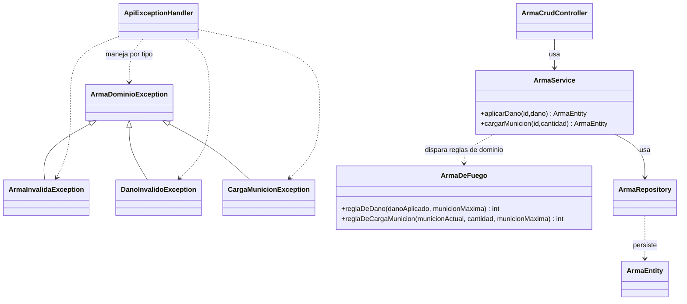

# cs2-armas-api

Servicio HTTP construido con **Spring Boot** (Maven, Java 21, Spring Web + Spring Data JPA + H2) sobre el modelado de **Counter-Strike 2**: inventario de armas con herencia, sobreescritura/sobrecarga, ocultamiento, CRUD REST persistido y reglas de negocio de **daño** y **carga de munición**.

Ejercicios: POO-06/07/08 del taller de Git y Lenguaje de Programación 3 (CYT646).  
POO-08: <https://github.com/alefq/afq-taller-git-2024/blob/main/docs/ejercicio-poo-08-crud-h2-insomnia-2026-10-28.md>

## Cómo arrancar

```bash
./mvnw spring-boot:run
```

Servicio: `http://localhost:8080`. Pruebas:

```bash
./mvnw test
```

## H2 y persistencia (desarrollo)

Configuración en `src/main/resources/application.properties`:
- `spring.datasource.url=jdbc:h2:mem:armasdb` — base H2 en memoria para desarrollo (rápida y reproducible).
- `spring.datasource.username=sa` / `spring.datasource.password=` — credenciales por defecto de H2 en desarrollo.
- `spring.h2.console.enabled=true` y `spring.h2.console.path=/h2-console` — habilita la consola web para inspeccionar tablas.
- `spring.jpa.hibernate.ddl-auto=update` — Hibernate crea/actualiza el esquema según las entidades JPA al arrancar.
- `spring.jpa.show-sql=true` — muestra SQL para depuración/observación.

Consola H2: `http://localhost:8080/h2-console` (JDBC URL `jdbc:h2:mem:armasdb`, usuario `sa`).

## CRUD REST (persistido en H2)

Recurso: `/api/armas-crud` (la URL nombra el recurso; el verbo HTTP indica la operación). El `id` lo asigna la persistencia (JPA/H2); no se envía en el `POST` de creación. El CRUD usa `ArmaRepository` (Spring Data, interfaz) y `ArmaService`; el controller no guarda listas en memoria.

| Operación | HTTP | URL | Éxito |
|---|---|---|---|
| Crear | `POST` | `/api/armas-crud` | 201 |
| Listar | `GET` | `/api/armas-crud` | 200 |
| Obtener por id | `GET` | `/api/armas-crud/{id}` | 200 / 404 |
| Actualizar | `PUT` | `/api/armas-crud/{id}` | 200 |
| Borrar | `DELETE` | `/api/armas-crud/{id}` | 204 |

```bash
curl -X POST "http://localhost:8080/api/armas-crud" -H "Content-Type: application/json" \
  -d '{"nombre":"AK-47","precio":2700,"tipo":"Fusil","dano":36,"municionActual":30,"municionMaxima":30}'
curl "http://localhost:8080/api/armas-crud"
curl "http://localhost:8080/api/armas-crud/1"
curl -X PUT "http://localhost:8080/api/armas-crud/1" -H "Content-Type: application/json" \
  -d '{"nombre":"M4A1-S","precio":3100,"tipo":"Fusil","dano":33,"municionActual":25,"municionMaxima":25}'
curl -X DELETE "http://localhost:8080/api/armas-crud/1" -i
```

## Reglas de negocio del juego (CS2) y excepciones

Las reglas viven en el **dominio** (`ArmaDeFuego.reglaDeDano` y `ArmaDeFuego.reglaDeCargaMunicion`) y el controller las dispara a través del servicio; el dominio lanza la excepción hija correspondiente.

1. **Daño:** el daño aplicado a un arma de fuego no puede ser negativo ni exceder el límite permitido (`municionMaxima * 5`) para ese arma.
2. **Carga de munición:** la cantidad a cargar debe ser > 0 y `municionActual + cantidad` no puede superar `municionMaxima`.

Jerarquía de excepciones (no comprobadas, `RuntimeException` vía `ArmaDominioException`, coherente con el dominio/servicio Spring):
- `ArmaDominioException` (base)
  - `ArmaInvalidaException`
  - `DanoInvalidoException`
  - `CargaMunicionException`

Handlers HTTP (uno por tipo, `ApiExceptionHandler`): cada tipo responde 400 con `tipo` distinto en JSON (`ARMA_INVALIDA`, `DANO_INVALIDO`, `CARGA_MUNICION_INVALIDA`, fallback `DOMINIO`).

Endpoints que aplican reglas persistiendo estado:
```bash
curl -X POST "http://localhost:8080/api/armas-crud/1/dano" -H "Content-Type: application/json" -d '{"dano":40}'
curl -X POST "http://localhost:8080/api/armas-crud/1/cargar-municion" -H "Content-Type: application/json" -d '{"cantidad":5}'
```

## Endpoints POO-06/07 (demostración de modelado)

- `GET /` — estado del servicio
- `GET /api/armas/descripcion` — `describir()` abstracto/sobreescrito (polimorfismo)
- `GET /api/armas/equipables` — capacidad `Equipable` (interfaz) entre familias distintas
- `GET /api/armas/ui` — capacidad `UIcapable` en todas las clases
- `GET /api/armas/fusil?...` / `GET /api/armas/humo?...` — construcción desde URL y sobrecarga

## Diagrama (resumen POO-08)



## Decisiones y notas (POO-08, trabajo actual)

- **Recurso/verbos:** la URL nombra el recurso (`/api/armas-crud`); el verbo HTTP expresa la operación (POST/GET/PUT/DELETE).
- **Identidad:** `id` autogenerado por JPA/H2 (`@GeneratedValue` en `ArmaEntity`); se omite al crear.
- **PUT:** reemplaza el estado editable del recurso (campos enviados) para el ítem indicado.
- **DELETE:** borra el ítem persistido y responde 204; un GET posterior por id devuelve 404.
- **Ocultamiento:** validaciones/invariantes se aplican en dominio/service; el controller no asigna estado inválido directamente.
- **Reglas en dominio:** las dos reglas de negocio (daño y carga de munición) están implementadas como métodos de `ArmaDeFuego` y lanzan excepciones hijas del dominio.

> Pendiente para cierre completo de POO-08: colección Insomnia versionada, simulación única REST que involucre las 3 clases y persista resultado visible en GET posterior, y ajustes de persistencia/Jackson para discriminación de subtipo según consigna.

## Estructura

```
src/main/java/py/edu/uc/lp3/Application.java
src/main/java/py/edu/uc/lp3/domain/                     modelado CS2 (POO-06/07)
src/main/java/py/edu/uc/lp3/entity/ArmaEntity.java     entidad JPA
src/main/java/py/edu/uc/lp3/repository/ArmaRepository   Spring Data (interfaz)
src/main/java/py/edu/uc/lp3/service/ArmaService.java    negocio/validación + reglas
src/main/java/py/edu/uc/lp3/rest/controller/            REST + handlers
src/test/java/py/edu/uc/lp3/                           pruebas dominio/HTTP
```

## Licencia

Apache License 2.0. Ver [LICENSE](LICENSE).

## Bitácora

- [BITACORA.md](BITACORA.md)
