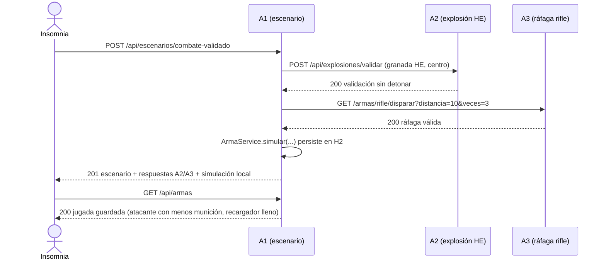
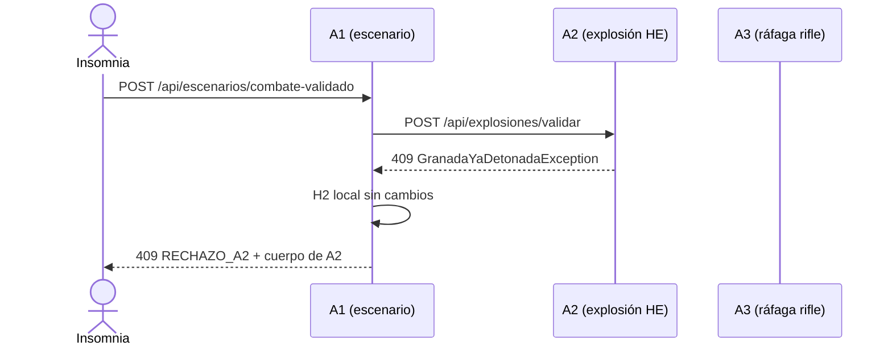
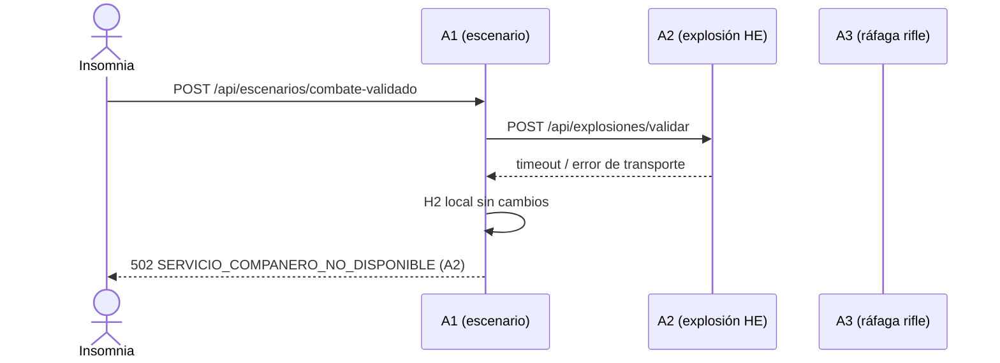
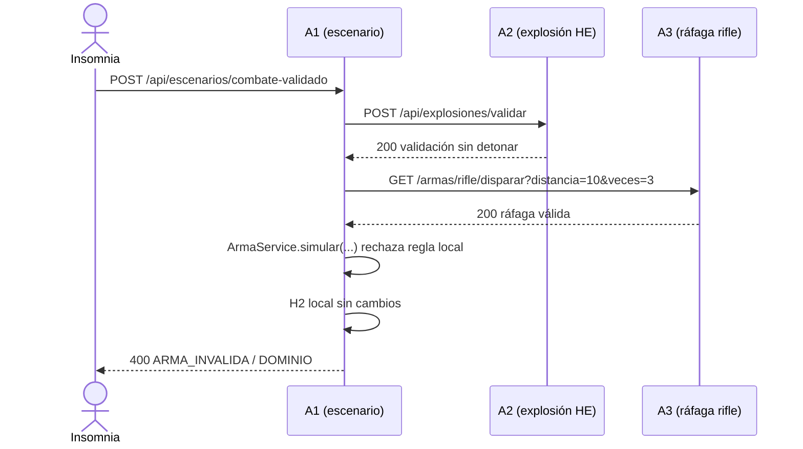

# POO-09 — Escenario de combate con APIs cruzadas (CS2)

**Navegación:** [Enunciado del práctico](https://github.com/alefq/afq-taller-git-2024/blob/main/docs/ejercicio-poo-09-ejemplo-uno-2026-11-16.md) · [Implementación A1](README.md)

Este caso sigue la forma del ejemplo de UNO, pero en CS2: **A1** (este proyecto) publica un recurso propio y llama a **A2** y **A3**. El cliente de Insomnia sólo conoce A1.

- **A1 — Mauricio Pecci** 
- **A2 — Ariel Gaona** 
- **A3 - Vanessa Ricciardi** 


Reglas tomadas:

| Compañero | Regla ajena | Endpoint del OpenAPI | Efecto |
|---|---|---|---|
| A2 | Sólo las granadas HE pueden detonar; el daño alcanza a jugadores vivos y empuja armas | `POST /api/explosiones/validar` | Calcula el resultado **sin mutar** el H2 de A2 |
| A3 | Un rifle puede disparar entre 1 y 100 veces con distancia no negativa | `GET /armas/{tipo}/disparar?distancia={d}&veces={n}` | Simula la ráfaga en memoria y respuesta `200` si la regla es válida |
| A1 | Un atacante dispara, un objetivo recibe daño y un tercer arma se recarga | `POST /api/armas/simulacion` | Persiste la simulación en el H2 local |

El hecho propio de A1 es `POST /api/escenarios/combate-validado`. A1 **no copia** las clases de A2 ni de A3: arma los pedidos según cada OpenAPI, espera las dos respuestas y recién después ejecuta su propia simulación. Si alguna regla ajena rechaza, el H2 de A1 queda igual.

## Camino feliz

Diagrama limpio: sólo el recorrido exitoso, sin ramas de error.



1. El cliente no conoce las URLs de A2 ni de A3: esas URLs salen de la configuración de A1.
2. A2 aplica su regla de explosión. El endpoint `/validar` es un *dry-run*: devuelve el resumen pero no detona ni persiste.
3. A3 aplica su regla de ráfaga en memoria. `veces=0` o `veces>100` daría `400`.
4. A1 ejecuta `ArmaService.simular(...)`, que ya valida los tres ids, el tipo de atacante/recargador, la munición y la distancia.
5. Un `GET /api/armas` posterior muestra el atacante con menos munición y el recargador con munición llena.

## Request

```http
POST /api/escenarios/combate-validado HTTP/1.1
Content-Type: application/json

{
  "simulacionLocal": {
    "atacanteId": 1,
    "objetivoId": 2,
    "recargadorId": 3,
    "distancia": 0,
    "critico": true,
    "municion": 10
  },
  "explosionA2": {
    "granadaId": 13,
    "x": 0,
    "y": 0,
    "z": 0
  },
  "rafagaA3": {
    "tipo": "rifle",
    "distancia": 10,
    "veces": 3
  }
}
```

Ejemplo con curl:

```bash
curl -i http://localhost:8080/api/escenarios/combate-validado \
  -H 'Content-Type: application/json' \
  -d '{
    "simulacionLocal": {
      "atacanteId": 1,
      "objetivoId": 2,
      "recargadorId": 3,
      "distancia": 0,
      "critico": true,
      "municion": 10
    },
    "explosionA2": {"granadaId": 13, "x": 0, "y": 0, "z": 0},
    "rafagaA3": {"tipo": "rifle", "distancia": 10, "veces": 3}
  }'
```

## URLs externalizables

Las URLs y las rutas ajenas no están escritas en la lógica del servicio: se leen desde `application.properties` y se pueden sobreescribir por variables de entorno.

| Propiedad | Variable de entorno | Valor por defecto |
|---|---|---|
| `api.a2.base-url` | `A2_BASE_URL` | `https://ariel.tail26e794.ts.net` |
| `api.a2.explosion-validar-path` | `A2_EXPLOSION_VALIDAR_PATH` | `/api/explosiones/validar` |
| `api.a3.base-url` | `A3_BASE_URL` | `http://100.95.213.93:8081` |
| `api.a3.rafaga-path` | `A3_RAFAGA_PATH` | `/armas/{tipo}/disparar` |

Ejemplo:

```bash
A2_BASE_URL=https://otro-host.test \
A3_BASE_URL=http://otro-host.test:8081 \
./mvnw spring-boot:run
```

## Rechazo de A2 — 400

A2 recibe un id que no es granada HE, por ejemplo `granadaId=3` (USP-S). A1 no llama a A3 y no persiste. El cuerpo del error identifica a A2 como autor del rechazo.

```mermaid
sequenceDiagram
    actor Cliente as Insomnia
    participant A1 as A1 (escenario)
    participant A2 as A2 (explosión HE)
    participant A3 as A3 (ráfaga rifle)

    Cliente->>A1: GET /api/armas (estado inicial)
    A1-->>Cliente: 200 estado inicial
    Cliente->>A1: POST /api/escenarios/combate-validado
    A1->>A2: POST /api/explosiones/validar
    A2-->>A1: 400 ArmaNoExplosivaException
    A1->>A1: no ejecuta simular; H2 queda igual
    A1-->>Cliente: 400 {"tipo":"RECHAZO_A2","companero":"A2",...}
    Cliente->>A1: GET /api/armas
    A1-->>Cliente: 200 estado igual al inicial
```

## Conflicto de A2 — 409

La granada HE ya fue detonada en el H2 de A2. A2 responde `GranadaYaDetonadaException`; A1 conserva su estado.



## Rechazo de A3 — 400

A2 aceptó, pero A3 recibe `veces=0`. Es el caso simétrico al rechazo de A2: A1 ya consultó a A2 con un *dry-run*, no hay escritura local y el cuerpo del error identifica a A3 como autor del rechazo.

```mermaid
sequenceDiagram
    actor Cliente as Insomnia
    participant A1 as A1 (escenario)
    participant A2 as A2 (explosión HE)
    participant A3 as A3 (ráfaga rifle)

    Cliente->>A1: GET /api/armas (estado inicial)
    A1-->>Cliente: 200 estado inicial
    Cliente->>A1: POST /api/escenarios/combate-validado
    A1->>A2: POST /api/explosiones/validar
    A2-->>A1: 200 validación sin detonar
    A1->>A3: GET /armas/rifle/disparar?veces=0
    A3-->>A1: 400 veces debe estar entre 1 y 100
    A1->>A1: no ejecuta simular; H2 queda igual
    A1-->>Cliente: 400 {"tipo":"RECHAZO_A3","companero":"A3",...}
    Cliente->>A1: GET /api/armas
    A1-->>Cliente: 200 estado igual al inicial
```

## Compañero no disponible — 502

Si falla el transporte HTTP (timeout, DNS, host caído), A1 no sabe si la regla se cumplió y decide no persistir.



## Regla local inválida — 400

Los dos compañeros aceptaron, pero la simulación de A1 no cumple una regla propia, por ejemplo ids repetidos o recargador que no es arma de fuego.



## Respuestas

| Situación | HTTP | `tipo` en el cuerpo |
|---|---|---|
| Escenario aceptado | `201` | — |
| Regla de A2 o A3 rechazada con `400` | `400` | `RECHAZO_A2` / `RECHAZO_A3` |
| Recurso ajeno no encontrado | `404` | `RECHAZO_A2` / `RECHAZO_A3` |
| Conflicto ajeno, por ejemplo granada ya detonada | `409` | `RECHAZO_A2` |
| Compañero no disponible | `502` | `SERVICIO_COMPANERO_NO_DISPONIBLE` |
| Regla local inválida | `400` | `ARMA_INVALIDA`, `DOMINIO`, `CARGA_MUNICION_INVALIDA`, etc. |

El cuerpo de rechazo incluye `companero`, `codigoExterno` y `cuerpoExterno` para que el cliente pueda identificar qué API ajena rechazó la operación.
